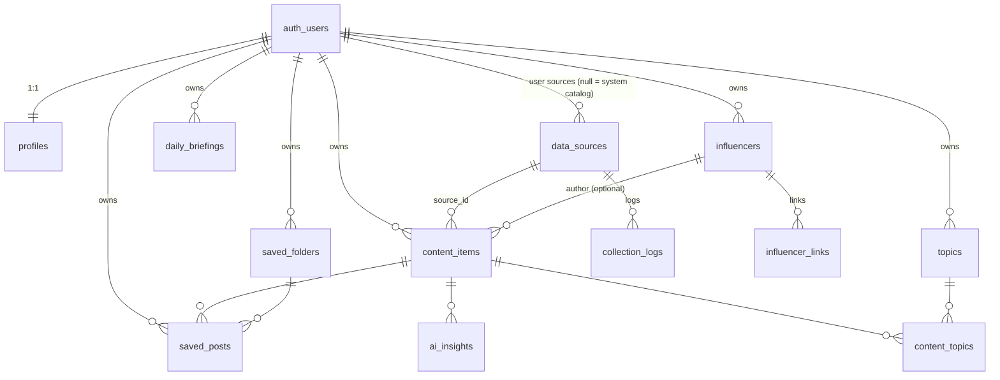

# LinkedIn Intelligence Hub

개인화 AI 지식·트렌드 인텔리전스 플랫폼 (MVP Phase 1 + Phase 2 콘텐츠 수집)

> LinkedIn과 제휴하지 않은 독립 서비스입니다. LinkedIn 데이터 수집을 전제로 하지 않으며, 모든 콘텐츠를 출처·권한 메타데이터와 함께 관리합니다. 근거는 [docs/api-feasibility-matrix.md](docs/api-feasibility-matrix.md)에 정리했습니다.

## 1. 아키텍처

```
Browser ──HTTPS──> Vercel (Next.js 16 App Router)
                     ├─ proxy.ts            세션 갱신 + 미인증 차단
                     ├─ Server Components   조회 (사용자 세션 + RLS)
                     ├─ Server Actions      CRUD (zod 검증 → Supabase)
                     └─ Route Handlers: /api/cron/collect (매일 06:00 KST, CRON_SECRET)
                              │
                              ▼
                    Supabase Cloud
                     ├─ Auth (이메일+비밀번호, 이메일 인증)
                     ├─ PostgreSQL + RLS (user_id 격리)
                     └─ 권한 트리거 (AI 처리 플래그 보호)
     수집기(src/lib/collectors): RSS·Atom / HN / GitHub / arXiv / HF → 주제 분류 → content_items
     (Phase 3) AIProvider(OpenAI, 교체 가능) ← ai_processing_allowed 콘텐츠만
```

| 영역 | 기술 |
|---|---|
| Frontend | Next.js 16, React 19, TypeScript, Tailwind CSS v4, shadcn/ui 방식 컴포넌트, Recharts, next-themes |
| Backend | Server Actions, Route Handlers, Proxy |
| DB/Auth | Supabase PostgreSQL, Supabase Auth (`@supabase/ssr`) |
| 검증 | zod |
| 출처 로고 | simple-icons (CC0) + 모노그램 + 도메인 favicon |

## 2. 폴더 구조

```
src/
  proxy.ts                     인증 프록시 (Next 16: middleware → proxy)
  app/
    (auth)/                    login, signup, forgot-password, auth/confirm, auth/update-password
    (app)/                     인증 필요 영역 (사이드바 레이아웃)
      page.tsx                 Dashboard
      trending/ influencers/ following/ topics/ topics/[id]/ knowledge/ saved/ settings/ search/
      */actions.ts             메뉴별 Server Actions
    setup/                     환경변수 미설정 안내
  components/
    ui/                        Button, Card, Badge, Input 등
    layout/                    Sidebar, Topbar
    content/                   ContentCard, SaveButton
    sources/                   SourceLogo, SourceBadge (출처 로고)
  lib/
    supabase/                  server / proxy / admin 클라이언트
    sources/registry.ts        출처 로고 레지스트리
    auth.ts                    Data Access Layer (requireUser)
    validation.ts queries.ts content.ts people.ts types.ts utils.ts env.ts
supabase/
  migrations/                  스키마·RLS·시드
  tests/rls_test.sql           RLS·권한 검증
scripts/e2e_smoke.py           Playwright E2E 스모크 테스트
docs/api-feasibility-matrix.md
```

## 3. ERD



- `profiles`가 요구사항의 `users` 테이블 역할을 합니다 (Supabase `auth.users`와 1:1).
- `influencers.is_following`으로 Influencers와 My Following을 구분합니다.
- `data_sources.logo_key`와 `brand_color`로 출처 로고를 표시합니다.

## 4. 출처 로고 규칙

`resolveSourceLogo()` (src/lib/sources/registry.ts)가 아래 순서로 로고를 정합니다.

1. `provenance = demo`이면 DEMO 로고와 DEMO DATA 배지를 표시합니다.
2. `logo_key`를 레지스트리에서 찾습니다. 직접 입력한 콘텐츠는 URL 도메인을 우선합니다 (예: linkedin.com 게시글 → LinkedIn).
3. 원문 URL의 호스트명을 레지스트리에서 찾습니다.
4. 등록되지 않은 도메인은 해당 사이트의 `favicon.ico`를 쓰고, 로드에 실패하면 이니셜 모노그램을 표시합니다.

LinkedIn, OpenAI, Microsoft, AWS는 simple-icons에서 제외된 브랜드라 공식 로고를 복제하지 않고 브랜드 컬러 모노그램으로 표시합니다. 새 소스는 `LOGO_REGISTRY`와 `HOST_MAP`에 한 줄씩 추가하면 됩니다.

## 5. 로컬 개발

```bash
npm install
npx supabase start -x studio,imgproxy,edge-runtime,logflare,vector,realtime,storage-api,postgres-meta,supavisor
npx supabase status -o env      # 키 확인 → .env.local 작성 (.env.example 참고)
npm run dev                     # http://localhost:3000
```

- 인증 메일 확인: Mailpit http://127.0.0.1:54324
- 전체 검증: `npm run verify:full` (= `verify`[typecheck·lint·test:unit·build] → `test:db` → `test:e2e`)
- 단위 테스트: `npm run test:unit` (Node 내장 테스트 러너, `tests/unit`)
- E2E 최초 1회: `uv run --with playwright==1.55.0 python -m playwright install chromium`
- 수동 수집: Settings > 콘텐츠 수집 > 지금 수집 (10분에 1회)
- Node 버전: 22 (`.nvmrc`, CI와 동일)

## 6. 배포 (Supabase Cloud + Vercel)

1. Supabase 프로젝트를 생성합니다 (리전 Northeast Asia (Seoul) 권장).
2. 마이그레이션을 적용합니다. 둘 중 하나를 선택하세요.
   - `npx supabase link --project-ref <ref>` 후 `npx supabase db push`
   - SQL Editor에 `supabase/migrations/20261109000000_init.sql` 붙여넣고 실행
3. Supabase Auth 설정을 합니다.
   - Authentication > URL Configuration: Site URL `https://<도메인>`, Redirect URLs `https://<도메인>/auth/confirm`
   - Email 인증(Confirm email)을 켜고, 비밀번호 최소 길이를 8로 설정합니다.
   - 운영 메일 발송에는 커스텀 SMTP 설정을 권장합니다 (기본 SMTP는 발송량 제한이 있음).
4. GitHub에 push한 뒤 Vercel에서 Import합니다.
5. Vercel 환경변수를 설정합니다.
   - `NEXT_PUBLIC_SUPABASE_URL`
   - `NEXT_PUBLIC_SUPABASE_PUBLISHABLE_KEY`
   - `SUPABASE_SECRET_KEY` (Sensitive로 지정)
   - `NEXT_PUBLIC_SITE_URL` (커스텀 도메인일 때만)
   - `CRON_SECRET` (Sensitive, `openssl rand -hex 32`) — Vercel Cron 이 `Authorization: Bearer` 로 전달
   - `GITHUB_TOKEN` (선택)
6. `vercel.json` 의 Cron(`0 21 * * *` = 06:00 KST)은 배포 시 자동 등록됩니다.

## 7. 보안 적용 현황

| 요건 | 구현 |
|---|---|
| RLS | 전 테이블 적용, `user_id = auth.uid()` |
| 서버 측 키 관리 | 비밀키는 `server-only` 모듈에서만 읽음, `NEXT_PUBLIC_` 접두사 금지 |
| 인증 | `getClaims()`로 JWT 서명 검증, 모든 Server Action에서 재검증 |
| 입력 검증·XSS | zod 검증, http(s) URL만 허용, React 이스케이프, 외부 링크 `rel=noopener noreferrer` |
| SQL Injection | supabase-js 파라미터 쿼리, PostgREST 필터 특수문자 제거 |
| 권한 위조 방지 | AI 처리 플래그·provenance 변경 차단 트리거, 다른 사용자 리소스 참조 차단 트리거 |
| Open redirect | `next` 파라미터는 내부 경로만 허용 |
| 보안 헤더 | HSTS, X-Frame-Options, nosniff, Referrer-Policy, Permissions-Policy |
| 데이터 삭제 | 콘텐츠 일괄 삭제, 계정 삭제(FK cascade) |
| 수집 요청 안전 | 타임아웃 10초, 응답 2MB 제한, 식별 User-Agent, 사용자 RSS는 https만 + 내부 IP 차단(SSRF) + 리다이렉트 재검사, XML 엔티티 선언 거부 |
| 수집 권한 | 수집 콘텐츠는 service role 로만 저장, 사용자 소스 권한 값은 DB 트리거가 강제, 수동 수집 10분 제한 |
| 남은 항목 | 앱 레벨 Rate Limiting(일반 API), 토큰 암호화(OAuth 도입 시), CSP, DNS rebinding 완전 차단 → Phase 3~4 |

## 8. 로드맵

- Phase 2 (완료): RSS·HN·GitHub·arXiv·HF 수집기, Vercel Cron, collection_logs, 키워드 기반 주제 분류, 사용자 RSS
- Phase 3: AIProvider(OpenAI), AI Summary/Insight, Topic Intelligence, Daily Briefing(07:00 KST, 재시도)
- Phase 4: 랭킹 고도화, RAG 검색(pgvector), 알림, 주간·월간 리포트, Reddit/X 커넥터(승인 시)
